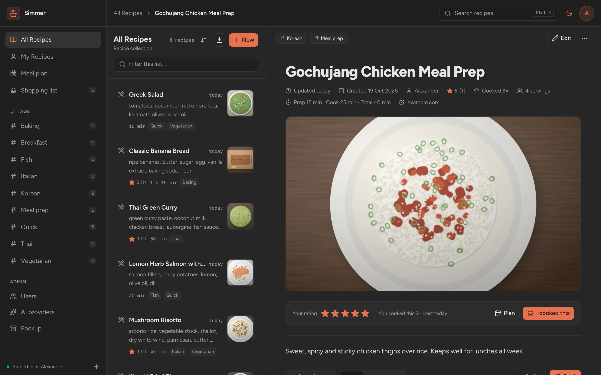
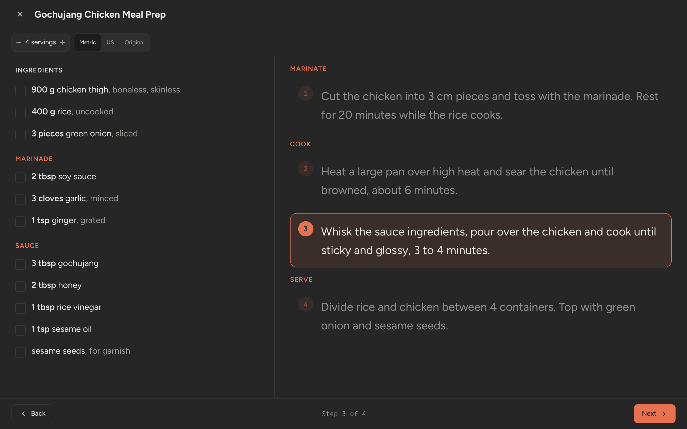
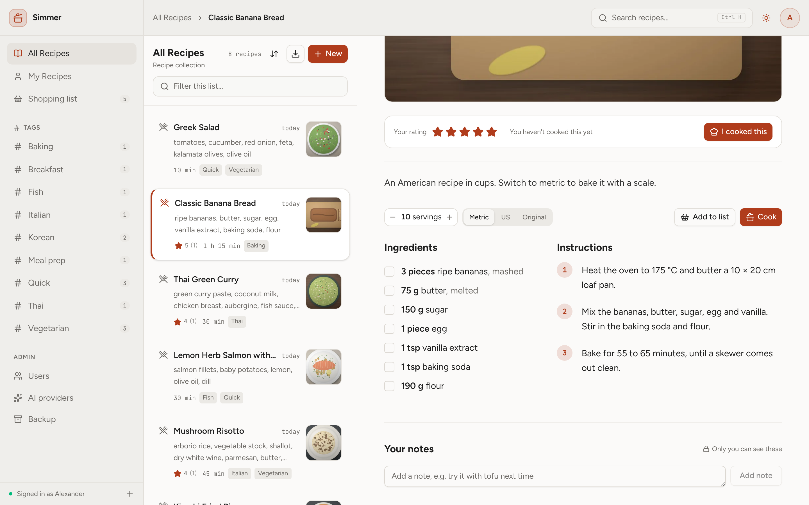
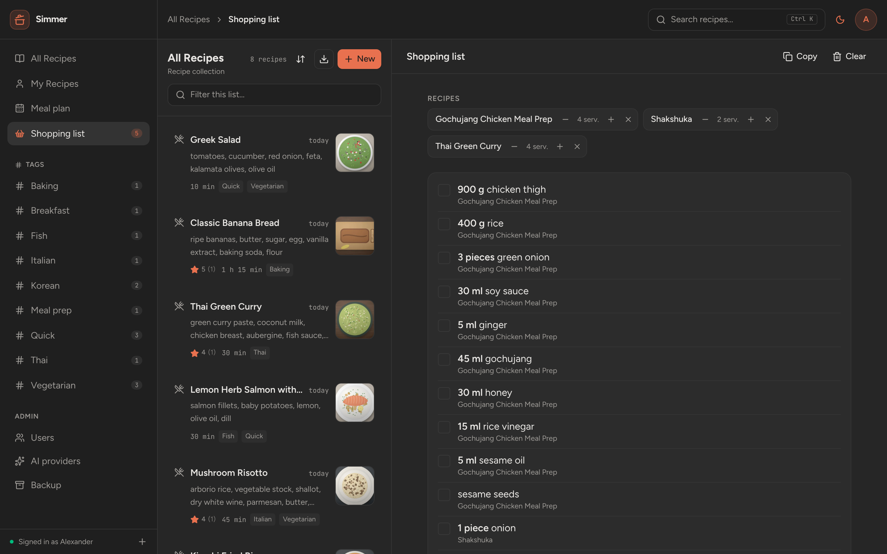
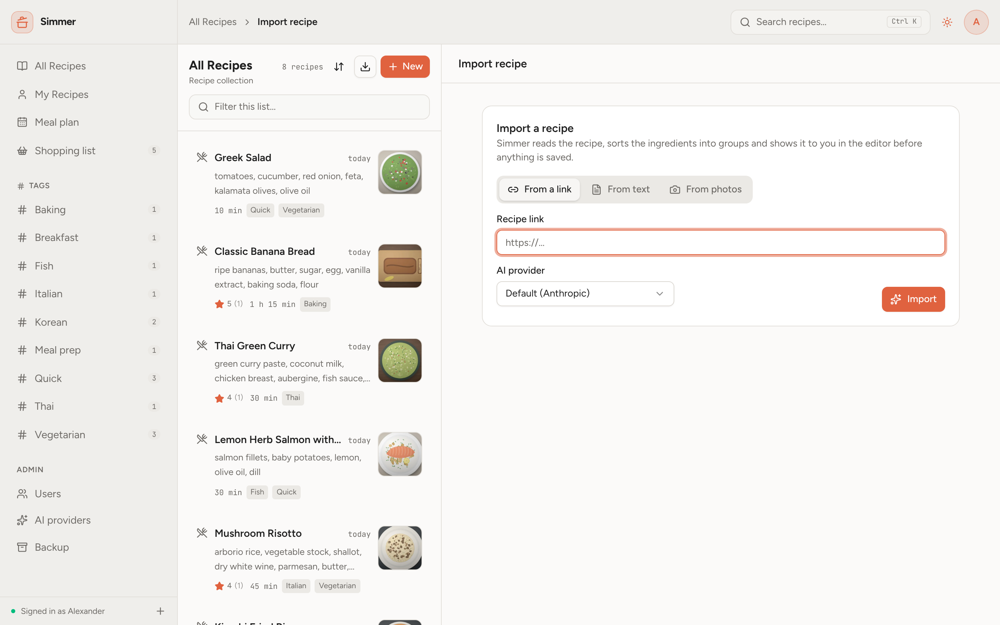
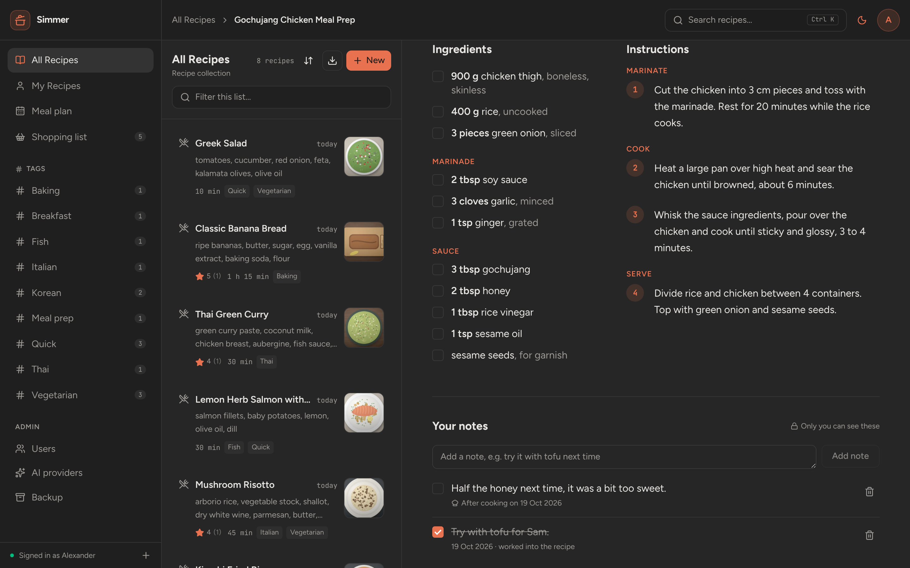
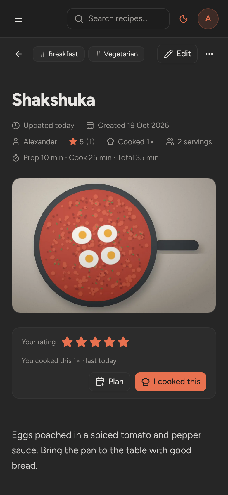
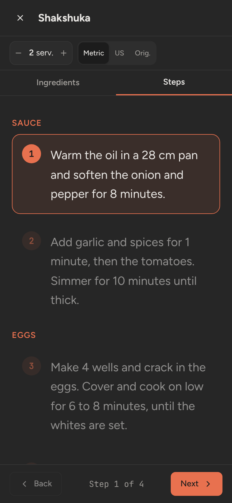

<div align="center">

# Simmer

**The recipe book for your household, on your own server.**

Collect recipes from anywhere, cook from a calm full-screen view and shop from one list.<br>
Self-hosted, with nothing to install on your phone.

[](https://github.com/KamiNeko/simmer/actions/workflows/ci.yml)
[](LICENSE)
[](backend/pyproject.toml)
[](frontend/package.json)



</div>

## Why Simmer?

Family recipes end up scattered across bookmarks, screenshots, cookbooks and chat messages. Simmer puts them in one place that everyone at home can use, on a server you run yourself.

- 🏠 **Yours.** One small Docker container with a SQLite file. No accounts elsewhere, no tracking, no ads.
- 👀 **Public to read, private to change.** Anyone you share a link with can read a recipe. Adding and editing needs an account, and your notes and ratings stay yours.
- ✨ **Imports that tidy up.** Paste a link, some text or photos of a cookbook page. An AI provider of your choice (Anthropic, OpenAI or Google Gemini) sorts the ingredients into groups and steps. It works without AI too, for sites that publish recipe data.
- ⚖️ **Grams when you want them.** Recipes keep the units they were written in and convert on the fly, including cups of flour to grams.

## Features

| | |
| :--- | :--- |
| 📖 **Recipes** | Ingredient groups (main, marinade, sauce, ...), step sections, photos, tags, prep and cook times, and a source link. Drag to reorder while editing. |
| 🔎 **Search** | Full-text search over titles, descriptions, ingredients and tags (`Ctrl+K`), with filters by tag and author and sorting by rating or how often you cook something. |
| 📥 **Import** | From a link, pasted text or up to six photos. Review everything in the editor before saving. **Tidy up** cleans an existing recipe. |
| ⚖️ **Units and servings** | Metric, US or as written, per person and per recipe. Scale servings up or down. Oven temperatures and pan sizes in the steps convert too. |
| 👩‍🍳 **Cooking view** | Large text, one highlighted step at a time, ingredient checkboxes, keyboard navigation and a screen that stays on. |
| ⭐ **Journal** | Rate recipes, log each time you cook them, and keep private notes like "needs more salt" that you tick off once you have worked them in. |
| 🛒 **Shopping list** | Adds up ingredients across recipes in your units, with your own extra items and tick-off as you shop. |
| 💾 **Export and backup** | Download all recipes as a portable zip, import it elsewhere, or take a full backup of the database and photos. |
| 🌗 **Light and dark mode** | Follows your system, or switch with one click. |
| 📱 **Responsive** | Works on phones and tablets as well as on the desktop. |

## Screenshots

<table>
  <tr>
    <td colspan="2"></td>
  </tr>
  <tr>
    <td colspan="2" align="center"><em>The cooking view: one step at a time, ingredients to tick off</em></td>
  </tr>
  <tr>
    <td colspan="2"></td>
  </tr>
  <tr>
    <td colspan="2" align="center"><em>A recipe written in cups, shown in grams</em></td>
  </tr>
  <tr>
    <td width="50%"></td>
    <td width="50%"></td>
  </tr>
  <tr>
    <td align="center"><em>One shopping list for several recipes</em></td>
    <td align="center"><em>Import from a link, text or photos</em></td>
  </tr>
  <tr>
    <td colspan="2"></td>
  </tr>
  <tr>
    <td colspan="2" align="center"><em>Ingredient groups, step sections and private notes</em></td>
  </tr>
</table>

<table>
  <tr>
    <td align="center"></td>
    <td align="center"></td>
  </tr>
  <tr>
    <td colspan="2" align="center"><em>On a phone</em></td>
  </tr>
</table>

## Getting started

You need Docker with Docker Compose, for example on a Proxmox LXC or a small home server.

```sh
git clone https://github.com/KamiNeko/simmer.git && cd simmer
cp .env.example .env                          # set SIMMER_BASE_URL, and optionally an admin account
mkdir -p data && sudo chown 1000:1000 data    # the container runs as uid 1000
docker compose up -d --build
```

Open `http://<your-server>:8080`. Without `SIMMER_ADMIN_USERNAME` and `SIMMER_ADMIN_PASSWORD` in `.env`, the first visit asks you to create the admin account. The admin then adds everyone else under **Users**; there is no public sign-up.

> [!IMPORTANT]
> Passwords and the login cookie travel with every request. Put Simmer behind a reverse proxy with **HTTPS** (Caddy, nginx, Nginx Proxy Manager, ...) before you use it outside your home network, and set `SIMMER_BASE_URL` to the `https://` address. [docs/self-hosting.md](docs/self-hosting.md) has ready-made proxy configs, including the upload size and timeout that imports need.

To use AI imports, an admin adds an API key under **AI providers**.

### Configuration

Set these in `.env` next to `docker-compose.yml`.

| Variable | Default | Purpose |
| --- | --- | --- |
| `SIMMER_BASE_URL` | `http://localhost:8080` | Public URL of the app, used in link previews. An `https://` address turns on secure cookies. |
| `SIMMER_ADMIN_USERNAME`, `SIMMER_ADMIN_PASSWORD` | unset | Admin account created on start, but only while no users exist. |
| `SIMMER_SECRET_KEY` | generated into `data/secret.key` | Encrypts the stored AI provider keys. If it changes, re-enter the keys. |
| `SIMMER_COOKIE_SECURE` | follows `SIMMER_BASE_URL` | Send the login cookie over HTTPS only. Set `false` only to try Simmer over plain http. |
| `SIMMER_SESSION_DAYS` | `30` | How many days a login lasts. |
| `SIMMER_DATA_DIR` | `/data` in Docker, `./data` otherwise | Where the database, photos and `secret.key` live. |
| `SIMMER_STATIC_DIR` | `/app/static` in Docker, unset otherwise | The built frontend. Unset means the backend serves only the API, which is what development uses. |
| `FORWARDED_ALLOW_IPS` | private network addresses in Docker | Read by Uvicorn: the proxies trusted to set `X-Forwarded-For` and `X-Forwarded-Proto`. Set it to your proxy's IP to be stricter. |

`SIMMER_STATIC_DIR` and `FORWARDED_ALLOW_IPS` are set in the Dockerfile. You rarely need to change the first one.

### Updating

```sh
git pull && docker compose up -d --build
```

Database migrations run automatically on start. Take a backup first. More in [docs/self-hosting.md](docs/self-hosting.md#updating).

### Backup and restore

Everything lives in the data folder (`./data` with the compose file):

- `simmer.db` is the SQLite database, with `simmer.db-wal` and `simmer.db-shm` next to it while Simmer runs.
- `photos/` holds the recipe photos.
- `secret.key` encrypts the AI keys, unless you set `SIMMER_SECRET_KEY`.

**Back up** from the app: an admin opens **Export & backup** in the account menu and presses **Download full backup**. The zip holds a consistent copy of `simmer.db` taken while Simmer runs, the photos and `secret.key`.

If you copy the folder by hand instead, stop the container first (`docker compose stop`) or copy `simmer.db-wal` and `simmer.db-shm` along with `simmer.db`. Recent changes may still sit in the WAL file, and a copy of `simmer.db` alone can miss them.

**Restore:**

```sh
docker compose stop
rm -rf data/*                      # or move it aside to keep a copy
unzip simmer-backup-YYYY-MM-DD.zip -d data
sudo chown -R 1000:1000 data
docker compose start
```

Clearing the folder matters: an old `simmer.db-wal` or `simmer.db-shm` next to a restored database can damage it. If you set `SIMMER_SECRET_KEY`, the backup has no `secret.key`, so keep the same value in `.env`.

**Recipe export is not a backup.** **Download recipes** (any signed-in user) gives a zip with `recipes.json` and the photos, meant for moving recipes to another Simmer. It leaves out accounts, ratings, cook logs, notes, shopping lists and AI settings. **Import recipes** reads such a zip and skips recipes whose title already exists. The person importing becomes the author.

## Documentation

- [Self-hosting](docs/self-hosting.md): Docker on a Proxmox LXC, reverse proxy examples, HTTPS, updates and troubleshooting.
- [AI import](docs/ai-import.md): setting up providers and what each import sends to them.
- [Architecture](docs/architecture.md): how the code is laid out and how to extend it.
- [Security](SECURITY.md): how Simmer protects your data and how to report a problem.
- [Changelog](CHANGELOG.md).
- The API reference is served by Simmer itself at `/api/docs`.

## How it works

**Units.** Amounts are stored as written and only converted for display, so switching never loses anything. Each user picks a default (metric, US or as written) in **Settings**, and every recipe page has a toggle and a servings scaler. Weights convert both ways. Cups become grams when the ingredient has a density (imports fill it in), otherwise millilitres. Tablespoons and teaspoons stay spoons below about 20 g. Counted things (eggs, cloves, cans) never convert. Oven temperatures and pan sizes in the steps convert too.

**Cook** opens a full-screen view with large text, ingredient checkboxes and one highlighted step at a time. The screen stays on while it is open, in browsers that support it.

**Shopping list.** **Add to list** on a recipe adds it at the servings you are viewing. The list adds up ingredients across recipes, shows them in your preferred units, and lets you add your own items and tick things off. Each user has their own list.

**Importing.** Use the import button next to **New**. Nothing is saved until you press Save. [docs/ai-import.md](docs/ai-import.md) explains what each kind of import sends to the AI provider.

## Who can do what

| | Visitor | Member | Admin |
| --- | --- | --- | --- |
| Browse and search recipes | ✓ | ✓ | ✓ |
| See average rating and cooked count | ✓ | ✓ | ✓ |
| Add recipes | | ✓ | ✓ |
| Edit or delete recipes | | own | all |
| Rate, log cooking, keep private notes | | ✓ | ✓ |
| Shopping list, recipe export and import | | ✓ | ✓ |
| Import recipes and use Tidy up | | ✓ | ✓ |
| Manage accounts and AI providers, full backup | | | ✓ |

## Contributing

Simmer is a FastAPI + SQLAlchemy backend with a React, TypeScript, Tailwind CSS and shadcn/ui frontend. [CONTRIBUTING.md](CONTRIBUTING.md) covers the setup, code style, database migrations and refreshing the screenshots.

CI runs these checks. Run them before you open a pull request:

```sh
cd backend
.venv/bin/ruff check app tests
.venv/bin/ruff format --check app tests
.venv/bin/pytest -q --cov --cov-report=term-missing:skip-covered   # fails below 90% coverage

cd ../frontend
npm run lint        # tsc type check plus oxlint
npm test            # vitest
npm run coverage    # vitest with coverage, fails below 40% of lines
npm run build
```

## License

[MIT](LICENSE)
